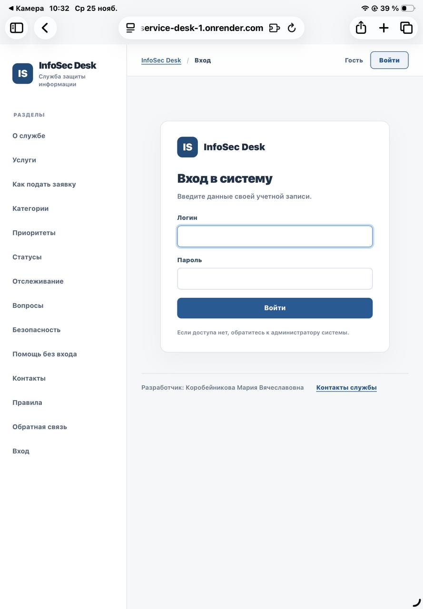

# Интерфейс на устройствах

Протокол составлен по десяти снимкам опубликованного сайта
[InfoSec Desk на Render](https://infosec-service-desk-1.onrender.com/),
полученным 25 ноября 2026 года. Использованы снимки iPad, iPhone и ПК Windows.
Все исходные изображения находятся в репозитории.

[Список устройств и контрольные суммы в JSON](devices_results.json).

## Снимки и наблюдения

| Устройство | Браузер | Страница и состояние | Снимок |
| --- | --- | --- | --- |
| iPad | Safari | Вход | [Открыть](browser_screenshots/real-devices/ipad-safari/01-login.jpg) |
| iPhone | Яндекс Браузер | Вход, страница прокручена | [Открыть](browser_screenshots/real-devices/iphone-yandex/01-login-scrolled.jpg) |
| iPhone | Safari | Вход и верхнее меню | [Открыть](browser_screenshots/real-devices/iphone-safari/01-login-menu.jpg) |
| iPhone | Safari | Вход, поле логина в фокусе | [Открыть](browser_screenshots/real-devices/iphone-safari/02-login-focused.jpg) |
| iPhone | Safari | Вход, страница прокручена | [Открыть](browser_screenshots/real-devices/iphone-safari/03-login-scrolled.jpg) |
| iPhone | Safari | Категории и прокрутка меню | [Открыть](browser_screenshots/real-devices/iphone-safari/04-categories-menu.jpg) |
| ПК Windows | Chrome | Вход | [Открыть](browser_screenshots/real-devices/windows-chrome/login.jpg) |
| ПК Windows | Chrome | Услуги | [Открыть](browser_screenshots/real-devices/windows-chrome/services.jpg) |
| ПК Windows | Microsoft Edge | Услуги, уведомления браузера | [Открыть](browser_screenshots/real-devices/windows-edge/services.jpg) |
| ПК Windows | Microsoft Edge | Вход | [Открыть](browser_screenshots/real-devices/windows-edge/login.jpg) |

## Планшет

На iPad в Safari страница входа использует широкую компоновку: слева меню,
справа форма логина и пароля. Видны заголовок, кнопка входа и подвал.

## Телефон

На iPhone меню размещается горизонтально над страницей. В Safari зафиксированы
верхняя часть страницы входа, фокус поля логина и вид формы после прокрутки.
Снимок категорий показывает прокрученное меню и текст справочного раздела.
В Яндекс Браузере показана форма входа после прокрутки: поля и кнопка
расположены в одну колонку.

[Фокус поля в Safari](browser_screenshots/real-devices/iphone-safari/02-login-focused.jpg),
[категории и меню](browser_screenshots/real-devices/iphone-safari/04-categories-menu.jpg),
[форма в Яндекс Браузере](browser_screenshots/real-devices/iphone-yandex/01-login-scrolled.jpg).

## ПК Windows

В Chrome и Microsoft Edge сняты вход и каталог услуг. На обоих экранах
применяется боковая навигация, основное содержимое расположено справа.
В каталоге видны описание службы и список услуг.

[Каталог в Chrome](browser_screenshots/real-devices/windows-chrome/services.jpg),
[каталог в Edge](browser_screenshots/real-devices/windows-edge/services.jpg).

## Проверка файлов

Для каждого из десяти JPEG проверены наличие файла, SHA-256 и размеры
изображения из его заголовка. Они совпали с метаданными браузерного комплекта.
Размеры изображения записаны как параметры файла; они отделены от размеров
области браузера, используемых при автоматической съёмке.

## Проверка адаптивной компоновки

Комплект дополнен 48 снимками Chrome и Firefox на Linux с эмуляцией области
браузера 1440 × 900, 1366 × 768, 768 × 1024 и 390 × 844 пикселя.
Шесть публичных страниц представлены на каждом размере в обоих браузерах.
Метаданные всех 48 снимков фиксируют загрузку CSS, готовность шрифтов
и отсутствие горизонтального переполнения всей страницы.

[Браузерный протокол](browser_protocol.md) и
[все 58 снимков](browser_screenshots/README.md) связывают материалы между собой.
