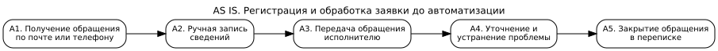
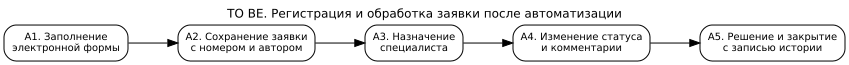
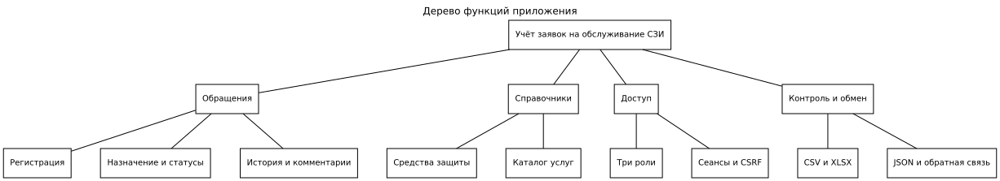
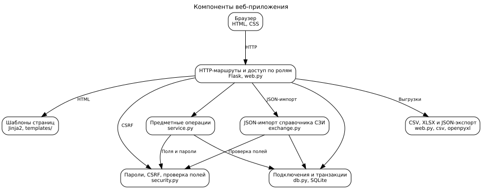

# Архитектура системы

## Назначение

InfoSec Service Desk предназначена для регистрации и обработки обращений по обслуживанию средств защиты информации. Веб-приложение работает на Windows и Ubuntu, а данные хранит в SQLite. Приложение не требует отдельного сервера баз данных.

HTTP-запросы обрабатывает Flask. HTML формируется шаблонами Jinja2, выгрузка XLSX использует openpyxl.

Схема архитектуры: [SVG](diagrams/architecture.svg), [PNG](images/architecture.png).

## Процесс до автоматизации



[Исходник DOT](diagrams/as_is.dot), [изображение PNG](diagrams/as_is.png).

Схема показывает исходную модель для сравнения с приложением: обращение
поступает по почте или телефону, сведения записываются вручную, затем передаются
исполнителю. После уточнения и устранения проблемы обращение закрывают в переписке.
Список и переписку приходится сопоставлять вручную, чтобы восстановить назначения
и последовательность действий.

В приложении эти сведения объединены в карточке заявки: исполнитель, статус,
комментарии и история изменений сохраняются вместе.

Повторное построение изображений при установленном Graphviz:

```bash
dot -Tsvg docs/diagrams/as_is.dot -o docs/diagrams/as_is.svg
dot -Tpng docs/diagrams/as_is.dot -o docs/diagrams/as_is.png
```

## Процесс после автоматизации



[Исходник DOT](diagrams/to_be.dot), [изображение PNG](diagrams/to_be.png).

Заявитель заполняет электронную форму. Приложение проверяет поля и сохраняет
заявку с номером, автором и первоначальным статусом «Новая». Специалист или
администратор назначает исполнителя из активных специалистов и администраторов.
Уточнения сохраняются в комментариях, изменения исполнителя и статуса отражаются
в журнале. После решения обращение переводится в статус «Закрыта».

Схема показывает основной путь обработки. Приостановка и возврат решённой заявки
в работу представлены на [схеме жизненного цикла](diagrams/lifecycle.svg).
Переходы проверяются сервером по `service.TRANSITIONS`. Регистрация заявки,
комментарии и изменения записываются в аудит; смена статуса также сохраняется
в отдельной истории статусов.

Повторное построение изображений:

```bash
dot -Tsvg docs/diagrams/to_be.dot -o docs/diagrams/to_be.svg
dot -Tpng docs/diagrams/to_be.dot -o docs/diagrams/to_be.png
```

## Дерево функций



[Исходник DOT](diagrams/functions.dot), [изображение PNG](diagrams/functions.png).

Дерево объединяет функции в четыре группы. Права на конкретные операции
приведены в [матрице маршрутов](route_matrix.md).

| Группа | Реализация |
| --- | --- |
| Обращения | Создание заявки, назначение исполнителя, смена статуса, история, комментарии и вложения |
| Справочники | Просмотр СЗИ; управление СЗИ и каталогом услуг администратором |
| Доступ | Вход, сеансы, три роли и проверка CSRF для запросов изменения данных |
| Контроль и обмен | Выгрузка заявок в CSV/XLSX специалистом и администратором; обмен справочником СЗИ в JSON администратором; обратная связь посетителей |

Заявитель работает со своими обращениями. Специалист и администратор обрабатывают
заявки; управление пользователями, справочниками и сообщениями обратной связи
доступно администратору. Личный кабинет, активность и уведомления дополняют
основные группы функций; подробные адреса страниц перечислены в матрице маршрутов.

Повторное построение изображений:

```bash
dot -Tsvg docs/diagrams/functions.dot -o docs/diagrams/functions.svg
dot -Tpng docs/diagrams/functions.dot -o docs/diagrams/functions.png
```

## Компоненты веб-приложения



[Исходник DOT](diagrams/components.dot), [изображение PNG](diagrams/components.png).

`web.py` принимает HTTP-запросы, проверяет доступ по ролям и передаёт данные
в шаблоны Jinja2. Предметные операции выполняет `service.py`; подключения
и транзакции SQLite предоставляет `db.py`. Маршруты также обращаются к базе
для чтения и экспорта данных.

`security.py` содержит проверку полей, хеширование паролей и функции CSRF.
Его используют маршруты, предметные операции и JSON-импорт справочника СЗИ.
Импорт выполняет `exchange.py`, а CSV, XLSX и JSON-экспорт реализованы
в `web.py`. Для XLSX используется openpyxl.

Блок выгрузок на схеме обозначает группу операций внутри `web.py`.
Схема описывает обработку веб-запросов; команды обслуживания базы описаны
в составе модулей и руководстве по запуску.

Повторное построение изображений:

```bash
dot -Tsvg docs/diagrams/components.dot -o docs/diagrams/components.svg
dot -Tpng docs/diagrams/components.dot -o docs/diagrams/components.png
```

## Состав модулей

- `web.py` - HTTP-маршруты, отображение форм, контроль доступа, проверка CSRF
- `service.py` - обработка заявок, переходы статусов, пользователи, справочники, аудит
- `db.py` - подключение к SQLite, миграция первичной схемы и транзакции
- `security.py` - хеширование паролей, проверка полей, защитные токены
- `__main__.py` - инициализация, демонстрационные данные, управление запуском
- `templates/` - страницы интерфейса
- `static/` - стили

## Сценарий обращения

1. Заявитель входит в систему и создает заявку.
2. Приложение проверяет значения и сохраняет заявку со статусом `new`.
3. Специалист назначает исполнителя, переводит заявку в `in_progress`.
4. После устранения проблемы специалист переводит заявку в `resolved`.
5. Заявка переводится в `closed`. Каждое изменение сохраняется в журнале.

Разрешены только заранее заданные переходы: `new` -> `in_progress`/`on_hold`; `on_hold` -> `in_progress`; `in_progress` -> `on_hold`/`resolved`; `resolved` -> `in_progress`/`closed`. Закрытая заявка не может быть снова открыта через интерфейс.

## Модель развертывания

В локальном варианте браузер обращается к процессу приложения по адресу `127.0.0.1:8000`. Он обслуживает HTML-страницы и взаимодействует с SQLite. Для сетевого варианта необходим обратный прокси с HTTPS, настройка ключа сессий, резервное копирование БД, управление правами операционной системы и эксплуатационный контроль.

## Ограничения

Система не выполняет непосредственную конфигурацию межсетевых экранов и антивирусов, не управляет секретными ключами и не подключена к корпоративным каталогам. Интеграция с существующими корпоративными системами запланирована как самостоятельный этап; ее нельзя считать выполненной.

## Интерфейс и доступность

Шаблоны используют единые компоненты оформления, явные подписи полей, доступную
клавиатурную навигацию и семантические заголовки. Сведения о текущей странице
обозначаются через `aria-current`. Ошибки ввода передаются как статусные сообщения.

Интерфейс адаптируется к узкому окну: навигация превращается в горизонтальный список,
карточки перестраиваются в две колонки, а таблицы прокручиваются внутри контейнера.
Визуальные решения основаны на принципах группировки и иерархии Apple HIG и
рекомендациях WCAG 2.2 по фокусу и идентификации полей.

### Обслуживание доступа

При утрате первоначального пароля локальный оператор с доступом к файлу базы
выполняет `python run.py reset-password`. Команда меняет хеш пароля существующего
администратора с записью операции в журнал. Это не публичный механизм
восстановления: удаленно выполнить его нельзя.

## Доработка сопровождающих модулей (2026)

- `exchange.py` - атомарный JSON-импорт и экспорт справочника средств защиты
- `maintenance.py` - резервирование SQLite и проверка локального манифеста версии

Файловый обмен не подтверждает подключение к корпоративным системам университета.
Проверка манифеста не выполняет установку обновления. Подробности в `docs/file_exchange.md`.
